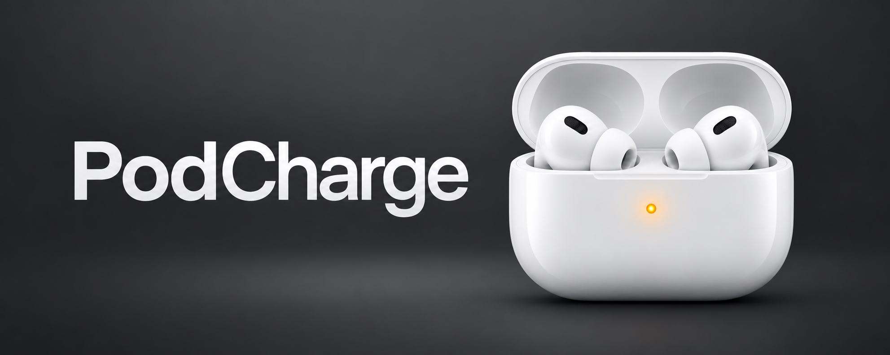
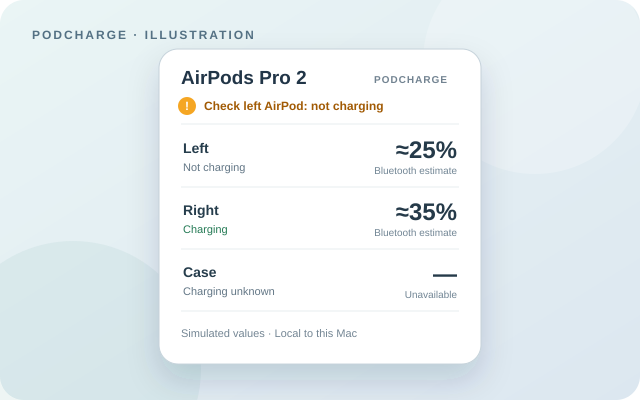

# PodCharge



**A small AirPods Pro 2 charging monitor for the macOS menu bar.** See left, right, and case battery estimates at a glance, or keep a tiny floating panel on your desktop. PodCharge is deliberately simple: it helps you notice when one earbud may not be charging, without becoming a device manager.

## What it does

- Shows left, right, and case battery estimates and available charging hints from nearby Bluetooth Low Energy (BLE) broadcasts.
- Marks missing and stale information instead of presenting it as live. Charging hints expire after 45 seconds without a new broadcast.
- Shows an amber menu bar badge when **both earbuds are below 50%**, exactly one reports charging, and fresh readings confirm the mismatch after **15 seconds**. It is a seating reminder, not a fault diagnosis.
- Offers a menu bar popover and an optional floating panel that you can keep on the desktop.

The currently tested hardware is **AirPods Pro (2nd generation, USB-C)**. PodCharge needs macOS 13 or later and Bluetooth permission. It first selects one currently connected supported pair. It can then listen for that selected pair's broadcasts while the earbuds are out of the audio connection, such as when they are in an open case.



*Illustration with simulated values, not a device capture or a promise of exact readings.*

## Build and install from a checkout

With Git and Xcode Command Line Tools or Xcode available, run this from a terminal:

```sh
cd /tmp &&
git clone https://github.com/Brechard/podcharge.git &&
cd podcharge &&
./scripts/build.sh &&
cp -R build/PodCharge.app /Applications/ &&
open /Applications/PodCharge.app &&
cd /tmp &&
rm -rf podcharge
```

Before reinstalling, quit PodCharge and move `/Applications/PodCharge.app` to the Trash. If cloning, building, copying, or opening fails, the `&&` chain stops and leaves the checkout in `/tmp/podcharge` for inspection.

The app is ad hoc signed, not Developer ID signed or notarized; macOS may apply its normal Gatekeeper checks. macOS may ask for Bluetooth permission again after a rebuild because the app is ad hoc signed.

Connect one AirPods Pro 2 USB-C pair before first launch so macOS can identify it. If needed, launch the installed app with `open -a /Applications/PodCharge.app --args --target-name "AirPods Pro"` to specify its Bluetooth name; add `--show-widget` to open the floating panel. The selection is saved in sandboxed preferences. If several paired devices share the same name, PodCharge may suppress readings because it cannot safely distinguish their broadcasts. Click the menu bar AirPods icon to open the popover and choose **Keep on desktop** for the panel.

For development, keep a checkout and run `./scripts/build.sh`; it creates `build/PodCharge.app` there without installing the app.

To uninstall, quit PodCharge and remove its app bundle. It installs no login item. To remove its saved selection and local status too, remove its sandbox container under `~/Library/Containers/org.podcharge.local/`.

## Deliberate limits

PodCharge reads the **public, undocumented** part of AirPods BLE broadcasts. Battery values are coarse estimates, not precise percentages; no reading is guaranteed while the case is closed or no usable broadcast arrives. A macOS battery value may be shown as a cached estimate, but it cannot establish live charging state. The app does not measure charging current or determine why an earbud is not charging. Firmware or macOS changes may affect the readings.

Broadcast association by name or a CoreBluetooth identifier is a convenience, **not cryptographic authentication**. Bluetooth scanning can receive broadcasts from nearby devices before the app filters them; the app is not restricted by the radio to the selected pair. The status file, including selected-device readings and timestamps, stays in the app's sandboxed container under `~/Library/Containers/`. Do not share that file without reviewing it.

There are no accounts, analytics, automatic updater, third-party packages, or network client/server entitlements. Updates are manual by design: review the source, build locally, and replace the app bundle when you choose. These design choices narrow the app's scope; they are not a guarantee that it is free of vulnerabilities. See [security reporting](SECURITY.md) and [local verification](Verification/README.md).

## Contributing and credits

Bug reports and small, focused contributions are welcome, especially security reviews and checks against supported hardware. Please avoid posting device names, addresses, captures, or local status files in public issues; use [private vulnerability reporting](SECURITY.md) for security findings. Run `./scripts/test.sh` and the [verification checks](Verification/README.md) before proposing behavior or security changes.

The [CAPod AirPods Pro 2 USB-C decoder fixture](https://github.com/d4rken-org/capod/blob/main/app/src/test/java/eu/darken/capod/pods/core/apple/ble/devices/airpods/AirPodsPro2UsbcTest.kt) and [podpower](https://github.com/t4t5/podpower) are references for the public BLE format; PodCharge is an independent implementation. Its charging-bit orientation was checked against that CAPod fixture. Thanks to [ClubTidy](https://clubtidy.fr).

PodCharge is available under the [MIT License](LICENSE).
